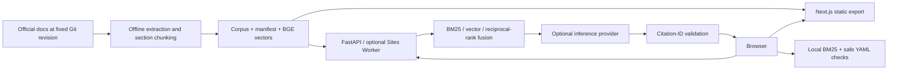

# Architecture and engineering decisions

## Why the index ships with the release

The corpus is small and changes less frequently than queries arrive. An immutable artifact removes ingestion from request serving and survives ephemeral free hosts. Content-derived IDs make deduplication explicit. The manifest contains corpus/embedding checksums and the source revision. Rollback restores code and data together.

## Why no production vector database yet

An exact matrix scan over 1,103 vectors is sufficient for the measured local corpus. A managed index becomes justified when the corpus, write frequency, replicas, tenancy, or access-control needs grow. The retrieval interface isolates that migration. Chroma from the original implementation is replaced by an explicit immutable vector matrix for the small demo deployment.

## Why there are two hosted adapters

FastAPI retains the Python/backend engineering path and supports Render deployment. The lightweight Worker serves an immediately publishable demo without requiring a separate hosting account. Both share the pinned corpus. Browser/Worker TypeScript retrieval and YAML checks are covered separately from Python checks. The Worker quantizes vectors to reduce bundle size; its semantic results are not included in the Python benchmark claim.

## Reliability and safety boundaries

No arbitrary crawler endpoints, model management endpoints, shell execution, or Kubernetes credentials. Inputs, history, output and requests are bounded. Provider calls have deadlines. Python uses a concurrency semaphore. Provider failures and citation-ID failures fall back to documentation evidence. Logs contain request ID, mode, timing, and source count, not prompt bodies.

Public evidence mode executes locally in the browser. When generation is enabled, prompts, retrieved passages and deterministic findings go to the configured provider; pasted YAML itself is checked locally/server-side and only findings are included in the generation prompt. Do not paste private operational material into a public demo.

## Deliberate limits

Process/isolate-local limits are useful overload protection, not a distributed billing guarantee. Configure provider account limits before enabling anonymous inference. CORS is not authentication or bot protection. Semantic neighbors always exist, so lexical support is also required before generation; this remains a heuristic and not a calibrated abstention classifier.

A citation referencing a supplied chunk is not proof of entailment. Human-reviewed groundedness and troubleshooting success remain separate evaluation work. Bounded model-directed multi-tool orchestration is deferred until it improves a reviewed benchmark; the shipped request path is a deterministic troubleshooting workflow.
